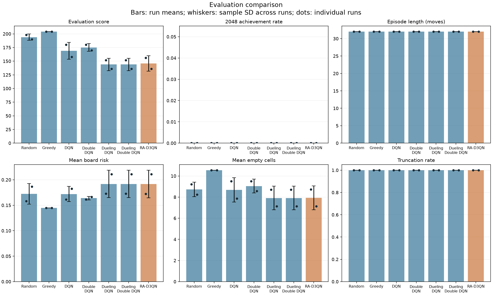
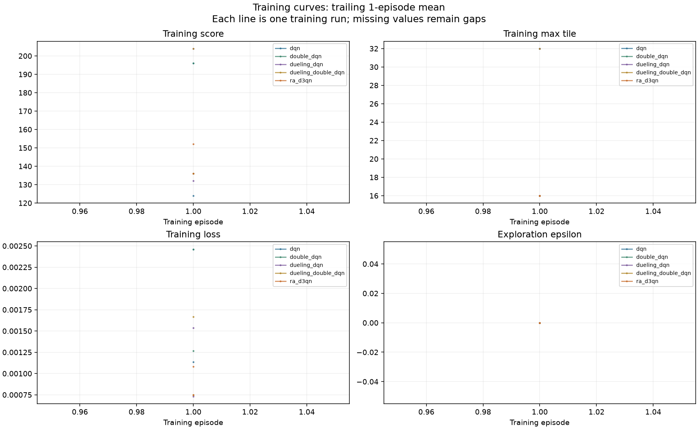
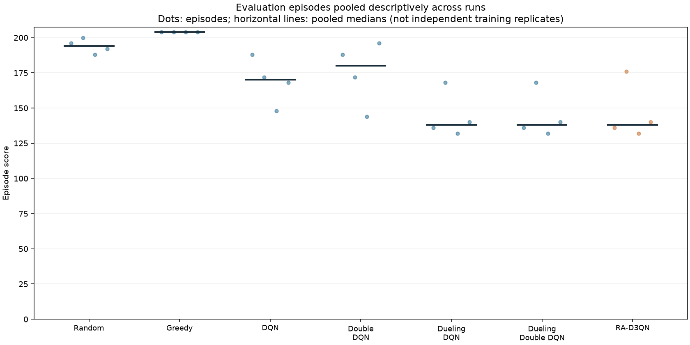

# Comparison analysis

Source: `/Users/harshkumar/Desktop/AU_Docs/AI_lab/Risk-Aware-Deep-Q-Learning-Agent-for-Playing-2048-in-a-Stochastic-Environment/results/comparison_smoke`
Run status: **completed**; recorded agent/seed runs: **14**.

This report is descriptive. It does not establish statistical significance, convergence, or a winning agent.

## Recorded settings

```json
{
  "training": {
    "episodes": 1,
    "max_steps_per_episode": 32,
    "epsilon_start": 0.0,
    "epsilon_end": 0.0,
    "epsilon_decay_steps": 300000,
    "checkpoint_every": 250,
    "illegal_move_penalty": 0.0,
    "game_over_penalty": 0.0
  },
  "evaluation": {
    "episodes": 2,
    "seed": 1000,
    "max_steps_per_episode": 32,
    "high_risk_threshold": 0.5
  },
  "risk": {
    "risk_coefficient": 0.1,
    "weights": {
      "mobility_weight": 1.0,
      "crowding_weight": 1.0,
      "game_over_weight": 1.0
    }
  },
  "seeds": [
    42,
    43
  ]
}
```

## Evaluation means

Values are means of run-level metrics +/- sample SD across runs. A single run has no estimated SD.

| Agent | Runs | Score | Episode length | Board risk | Truncation rate |
| --- | ---: | ---: | ---: | ---: | ---: |
| random | 2 | 194.000 +/- 5.657 | 32.000 +/- 0.000 | 0.172 +/- 0.020 | 1.000 +/- 0.000 |
| greedy | 2 | 204.000 +/- 0.000 | 32.000 +/- 0.000 | 0.145 +/- 0.000 | 1.000 +/- 0.000 |
| dqn | 2 | 169.000 +/- 15.556 | 32.000 +/- 0.000 | 0.172 +/- 0.015 | 1.000 +/- 0.000 |
| double_dqn | 2 | 175.000 +/- 7.071 | 32.000 +/- 0.000 | 0.164 +/- 0.003 | 1.000 +/- 0.000 |
| dueling_dqn | 2 | 144.000 +/- 11.314 | 32.000 +/- 0.000 | 0.192 +/- 0.027 | 1.000 +/- 0.000 |
| dueling_double_dqn | 2 | 144.000 +/- 11.314 | 32.000 +/- 0.000 | 0.192 +/- 0.027 | 1.000 +/- 0.000 |
| ra_d3qn | 2 | 146.000 +/- 14.142 | 32.000 +/- 0.000 | 0.192 +/- 0.027 | 1.000 +/- 0.000 |

## Interpretation limits

- Error bars are sample standard deviations, not confidence intervals.
- Evaluation episodes share trained policies; pooled episodes are not independent training replicates.
- Greedy repeats across seeds are deterministic repeats, not independent training samples.
- Training curves use episode indices; survival differences imply different numbers of steps/updates.
- Risk metrics are pooled over decision states within each run, then averaged across runs here.
- Missing warm-up losses remain missing. Short/smoke runs cannot demonstrate convergence.
- **Truncated evaluation episodes are present:** scores and episode lengths are capped observations, not complete-game outcomes.

## Figures







## Next experimental work

Run substantive multi-seed training, inspect learning curves, and then evaluate on held-out seeds. Tune risk settings on validation runs, not the final test results.
